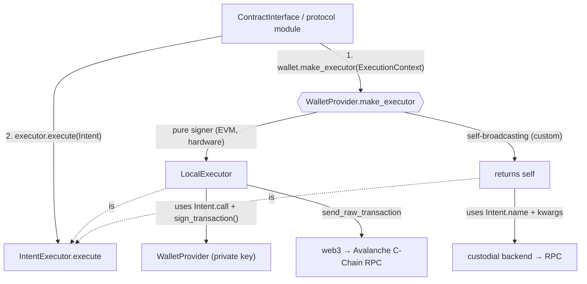

# Wallets

## Overview

The `wallets` module owns two responsibilities in the avaxagent SDK:

1. **Signing** - the `WalletProvider` interface (`address`, `sign_message`, `sign_transaction`, `sign_typed_data`). All protocol modules and config objects accept a `WalletProvider`, so signing backends are swappable without touching application code.
2. **Execution** - the `IntentExecutor` interface (`execute(Intent)`), which runs a high-level on-chain operation end-to-end (build + sign + broadcast, or delegate to an external backend). This is the seam that lets a wallet either be signed-and-broadcast _by_ the SDK, or broadcast _itself_.

`WalletProvider` is the **primary** way to configure signing across the SDK. `AgentConfig` accepts `wallet_provider=` directly, or auto-wraps `private_key` + `wallet_password` into an `EVMWalletProvider` at construction time (clearing the plaintext key immediately).

> Avalanche fork: the upstream TWAK (Trust Wallet Agent Kit) provider and the MegaFuel paymaster path are not ported - the twak CLI and MegaFuel only support BNB Chain. Every built-in provider here is a **pure signer**; gas is paid in AVAX.

## Architecture

There are **two kinds of wallets**, distinguished by who broadcasts:

| Kind | Examples | Who broadcasts | Executor |
| --- | --- | --- | --- |
| **Pure signer** | `EVMWalletProvider`, hardware | The SDK | A shared `LocalExecutor` wraps the signer |
| **Self-broadcasting** | Custom subclasses only (none built in) | The wallet itself | The wallet _is_ its own executor |

A pure signer is just a key - it has no web3 connection, so it must be handed one (an `ExecutionContext`) to broadcast. A self-broadcasting wallet carries its own connection. To keep callers from branching on wallet kind, each wallet exposes `make_executor(context)` and decides for itself:



The `Intent` is **dual-representation** so each executor consumes what it understands:

- `call` - a pre-encoded web3 `ContractFunction`. Used by `LocalExecutor`, which stays protocol-agnostic (it never inspects `name`/`kwargs`).
- `name` + `kwargs` - the operation as a namespaced id (e.g. `"erc8004.register"`) plus its high-level args. Used by semantic (self-broadcasting) backends that rebuild the call from intent and cannot accept raw calldata.

The call site (a contract client that already holds the ABI) produces both forms cheaply, so the asymmetry between backends never leaks protocol knowledge into any executor.

## Key Concepts

- **WalletProvider interface** - an `ABC` where only `address` is abstract. The `sign_*` methods default to raising `UnsupportedWalletOperation` - overriding one _is_ the capability declaration. Two factories absorb backend differences: `make_executor(context)` (default: wrap self in a `LocalExecutor`, gated on `sign.transaction`) and `make_x402_payer()` (default: capability gate; delegated backends override it).
- **Capabilities** - an open set of strings (`avaxagent.wallets.capabilities`) answering "can this wallet do X": `sign.*` values are auto-derived from method overrides, everything else is declared via `_extra_capabilities`. Query with `supports(cap)` / `capabilities()` / `describe()["capabilities"]`. Consumers ignore unknown values and treat absence as unsupported (the EIP-5792 omission rule).
- **IntentExecutor interface** - an `ABC` defining `execute(Intent)`. The local path and self-broadcasting backends are peer implementations.
- **Intent / ExecutionContext** - `Intent` is the operation to run; `ExecutionContext` carries the web3 connection (and optional receipt timeout) that a pure signer needs to broadcast.
- **LocalExecutor** - the default executor: build + sign (via a `WalletProvider`) + broadcast via web3 (self-paid AVAX gas, legacy `gasPrice`), with nonce management, pre-flight simulation, gas-price flooring and retry/backoff.
- **Keystore V3 encryption** - `EVMWalletProvider` stores private keys encrypted (scrypt KDF + AES-128-CTR), compatible with MetaMask and Geth.
- **In-memory mode** - `EVMWalletProvider(persist=False)` keeps the key in memory only. Used internally when configs auto-wrap a `private_key`.
- **Auto-creation** - when no private key is supplied and `persist=True`, `EVMWalletProvider` generates a new keypair and persists the keystore.

## Quick Start

```python
from avaxagent.wallets import EVMWalletProvider

# Import an existing private key (encrypted + persisted to disk)
wallet = EVMWalletProvider(password="secure-pw", private_key="0x...")
print(wallet.address)

# In-memory only (no disk I/O - used by config auto-wrap)
wallet = EVMWalletProvider(password="pw", private_key="0x...", persist=False)

# Auto-generate a new wallet (persisted to ~/.avaxagent/wallets/<address>.json)
wallet = EVMWalletProvider(password="secure-pw")
```

## Selecting a Provider & Key Storage

There is **no shared key store** across providers - each owns its own custody, and an agent picks exactly one:

| Provider | `kind` | `key_location` |
| --- | --- | --- |
| `EVMWalletProvider` | `evm` | `~/.avaxagent/wallets/<address>.json` (Keystore V3) |
| `MPCWalletProvider` | `mpc` | external MPC enclave (subclass-defined) |
| `TurnkeyWalletProvider` | `turnkey` | [Turnkey](https://docs.turnkey.com)'s AWS Nitro enclave — the key never leaves it; the agent holds only a local P-256 API key |

Treat "choose a provider" as "choose a custodian"; use `describe()` / `key_location` to report where a wallet's key lives without unifying storage.

`create_wallet_provider(kind, **kwargs)` is the single creation entry point - it unifies _selection_, not storage:

```python
from avaxagent.wallets import create_wallet_provider

wallet = create_wallet_provider("evm", password="pw")   # -> EVMWalletProvider
wallet = TurnkeyWalletProvider.from_env()                # -> TurnkeyWalletProvider (TURNKEY_* env)
print(wallet.describe())  # {"kind": "turnkey", "address": "0x..", "key_location": "...",
                          #  "exists": True, "capabilities": ["calls.arbitrary", "sign.message", ...]}
create_wallet_provider("twak")  # ValueError: Unknown wallet kind (not on Avalanche)
```

Configs accept a `wallet_kind` for non-EVM providers (the `evm` path stays on the `private_key` + `wallet_password` convenience flow):

```python
config = AgentConfig(wallet_kind="turnkey", network="avalanche-fuji")
# -> __post_init__ builds TurnkeyWalletProvider.from_env(...) via the factory
```

## API Reference

### `WalletProvider` (ABC)

| Member | Description |
| --- | --- |
| `address` (property) | Wallet's Ethereum address. The only abstract member. |
| `sign_transaction(tx)` | Sign a transaction dict. Returns `rawTransaction`, `hash`, `r`, `s`, `v`. Default raises `UnsupportedWalletOperation`; overriding declares `sign.transaction`. |
| `sign_message(msg)` | EIP-191 personal sign. Returns `messageHash`, `r`, `s`, `v`, `signature`. Default raises; overriding declares `sign.message`. |
| `sign_typed_data(domain, types, message)` | EIP-712 typed-data sign, gated by a `SigningPolicy`. Default raises; overriding declares `sign.typed_data`. |
| `capabilities()` | Set of capability strings: auto-derived `sign.*` + `_extra_capabilities`. |
| `supports(cap)` | Membership test on `capabilities()`. |
| `make_executor(context)` | Return the `IntentExecutor` for this wallet. Default: wrap self in `LocalExecutor`; requires `sign.transaction` and raises at this construction point when absent. |
| `make_x402_payer(**kw)` | Return the `X402Payer` for this wallet. Default: capability gate (raises `UnsupportedWalletOperation`); delegated payment backends override it. `kwargs` forward verbatim to the payer constructor. |
| `kind` (class attr) | Stable provider id (`"evm"` / `"turnkey"` / `"mpc"`); used by the factory and introspection. |
| `key_location` (property) | Human-readable custody location, or `None` if unknown/not applicable. |
| `exists()` | Whether durable key material backs this provider (never raises). |
| `describe()` | Uniform, non-sensitive summary: `{kind, address, key_location, exists, capabilities}`. |

### `EVMWalletProvider`

Production wallet provider backed by a local private key with Keystore V3 encryption. Uses the default `make_executor` (→ `LocalExecutor`).

| Method | Description |
| --- | --- |
| `__init__(password, private_key=None, persist=True)` | Import a key or load/create an encrypted wallet. |
| `export_private_key()` | Return the hex private key (handle with care). |
| `export_keystore(password)` | Return a Keystore V3 JSON dict encrypted with the supplied password. The provider does not retain its construction password. |
| `get_wallet_info()` | Return `{"address": "0x..."}` (no secrets). |

Constructor behavior:

1. If `private_key` is provided: import and encrypt it (save to disk only if `persist=True`).
2. If `persist=True` and no key: load existing keystore from state file, or create a new wallet.
3. If `persist=False` and no key: raises `ValueError` (key is required for in-memory mode).

### `LocalExecutor`

Default `IntentExecutor`. Builds, signs (via the wrapped `WalletProvider`) and broadcasts `intent.call` through web3 (gas self-paid in AVAX at `max(eth_gasPrice × 1.2, per-chain floor)`; the C-Chain floor is 1 wei). Owns nonce management, pre-flight `eth_call`, gas-price flooring and retry.

### `Intent` / `IntentExecutor` / `ExecutionContext`

- `Intent(name, kwargs, call, value, gas, description)` - a single high-level operation in both semantic and mechanical form.
- `IntentExecutor.execute(intent) -> dict` - returns at least `{"transactionHash", "receipt"}` (executors may add `agentId`, etc.).
- `ExecutionContext(web3, receipt_timeout=None)` - the context a pure signer needs to build a `LocalExecutor`.

### `TurnkeyWalletProvider`

Pure signer over [Turnkey](https://docs.turnkey.com)'s remote key-management API: the private key is generated and held inside Turnkey's AWS Nitro enclave and never leaves it; every sign call is an HTTPS activity stamped by a locally held P-256 API key pair (`pip install 'avaxagent[turnkey]'` for the `cryptography` extra, imported lazily on first use). Same capability surface as `EVMWalletProvider` (`sign.*` x3 + `calls.arbitrary`), so ERC-8004 writes ride the default `LocalExecutor` and x402 rides `X402Signer` unchanged.

```python
from avaxagent.wallets import TurnkeyWalletProvider

# env: TURNKEY_API_PUBLIC_KEY / TURNKEY_API_PRIVATE_KEY / TURNKEY_ORG_ID /
#      TURNKEY_SIGN_WITH (the wallet account's 0x ADDRESS, not a wallet id)
wallet = TurnkeyWalletProvider.from_env(expected_chain_id=43113)  # Avalanche Fuji
```

Operational constraints (the same list as the TypeScript provider):

- **Every successful signature is billed** — free tier 25/month at 1 request/second; pay-as-you-go $0.10/signature. All SDK-side guards (`SigningPolicy`, the `expected_chain_id` pin, input validation) run *before* the API call, so a refusal never costs quota.
- **Root API keys bypass ALL Turnkey server-side policies** (root quorum). Production deployments need a non-root API user plus an explicit ALLOW policy; this cannot be detected client-side.
- **Broadcast is never delegated** (Turnkey's managed broadcast is a paid feature) — the default `LocalExecutor` broadcasts over the SDK's own RPC.
- EIP-712 payloads are built by this module with the `EIP712Domain` entry always included, and EIP-191 messages are hashed locally and blind-signed (Turnkey's policies cannot see message content — content-level control is the SDK-side policy's job). Supported transactions: legacy + EIP-1559 (no access lists).

Live verification: `TURNKEY_E2E=1 uv run python examples/turnkey_e2e.py` (4 billed signatures; see the script header).

### `MPCWalletProvider` (stub)

Stub-by-design slot for external MPC custody such as Coinbase CDP or Fireblocks: subclass it and implement `address` plus the `sign_*` methods your backend supports - `capabilities()` derives the matching `sign.*` entries from those overrides automatically. The raise-only `sign_*` stubs were removed (an override that only raises would falsely claim the capability); unimplemented methods keep the raising base default. Direct instantiation still raises `NotImplementedError`.

### `capabilities` (module)

The open capability registry - plain string constants, not an Enum, so third parties can add vendor-namespaced values without touching the core:

| Constant | Value | Source |
| --- | --- | --- |
| `SIGN_MESSAGE` / `SIGN_TRANSACTION` / `SIGN_TYPED_DATA` | `sign.message` / `sign.transaction` / `sign.typed_data` | Auto-derived from `sign_*` overrides. |
| `CALLS_ARBITRARY` | `calls.arbitrary` | `_extra_capabilities` - arbitrary mechanical contract calls (vs a fixed menu). |
| `BROADCAST_SELF` | `broadcast.self` | `_extra_capabilities` - the wallet is its own executor. |
| `INTENTS_ERC8004` | `intents.erc8004` | `_extra_capabilities` - native ERC-8004 intent execution. |
| `X402_PAY` | `x402.pay` | `_extra_capabilities` - the SDK can complete an x402 payment with this wallet. Declare only when a buyer path can settle. |

Consumers ignore unknown values and treat absence as unsupported; never probe by calling and catching.

### `UnsupportedWalletOperation` / `WalletIdentityMismatch`

- `UnsupportedWalletOperation(NotImplementedError)` - a wallet backend cannot service an operation. The message is assembled from the capability/operation name, the reason, an alternative path, and an optional free-form `ref` pointer. Subclasses `NotImplementedError`, so existing `except NotImplementedError` callers keep working.
- `WalletIdentityMismatch(RuntimeError)` - a provider pinned with `expected_address` resolved to a different address (usually a stale or wrong-environment secret bundle). Fix the bundle, never the pin (INV-4).

### `MessageSigner` / `TypedDataSigner` (protocols)

Narrow, structural (PEP 544) signing protocols for _consumers_ - each is the exact dependency surface of one consumer (`address` + the single `sign_*` it calls), mapping 1:1 to `sign.message` / `sign.typed_data`. `X402Signer` takes a `TypedDataSigner`. Any duck-typed object with the right shape works - no `WalletProvider` inheritance required.

## Config Auto-Wrap

`AgentConfig` supports a convenience pattern:

```python
from avaxagent.core.config import AgentConfig
from avaxagent.wallets import EVMWalletProvider

# These are equivalent:
config = AgentConfig(
    wallet_provider=EVMWalletProvider(password="pw", private_key="0x...", persist=False)
)

config = AgentConfig(private_key="0x...", wallet_password="pw")
# -> __post_init__ auto-wraps into EVMWalletProvider(persist=False)
# -> private_key is cleared to "" (no plaintext retained)
```

The `from_env()` class methods read `PRIVATE_KEY` + `WALLET_PASSWORD` from environment variables and perform the same auto-wrap.

## Implementing a Custom Provider

The onboarding contract is five steps (design doc §7):

1. **Subclass `WalletProvider`; implement `address` plus only the `sign_*` methods you truly support.** The matching `sign.*` capabilities are auto-derived from the overrides - **never override a `sign_*` method just to raise** (the base default already raises a descriptive `UnsupportedWalletOperation`, and an override-to-raise would falsely claim the capability).
2. **Declare `kind` and your execution-side capabilities** via `_extra_capabilities` (`calls.arbitrary` for arbitrary calls, or `broadcast.self` + `intents.*` for a fixed-menu backend).
3. **Override `make_executor()` only if you self-broadcast** (return `self` + an intent dispatch table); a pure signer does nothing and gets the default `LocalExecutor`. **Override `make_x402_payer()` only for a delegated payment backend** (one that handles the whole 402 flow itself).
4. **Register the kind in `create_wallet_provider`** (`factory.py`).
5. **Copy the conformance test template** (`tests/test_wallet_conformance.py`): every declared capability must work, every undeclared one must raise `UnsupportedWalletOperation`.

**A pure signer** (a signing-type MPC backend, hardware wallet, or similar backend) is just steps 1-2; it inherits the default `make_executor` (→ `LocalExecutor`), so the SDK builds and broadcasts for it - and implementing `sign_typed_data` alone makes it x402-capable via `X402Signer`:

```python
from avaxagent.wallets.wallet_provider import WalletProvider

class HardwareWalletProvider(WalletProvider):
    kind = "hardware"

    @property
    def address(self) -> str:
        return self._hw_address

    # Implement only what the device truly supports - each override
    # declares the matching sign.* capability automatically.
    def sign_transaction(self, transaction: dict) -> dict:
        ...  # Delegate to hardware device

    def sign_message(self, message: str) -> dict:
        ...  # Delegate to hardware device

    def sign_typed_data(self, domain, types, message) -> dict:
        ...  # Delegate to hardware device
```

**A self-broadcasting wallet** also implements `IntentExecutor` and overrides `make_executor` to return itself:

```python
from avaxagent.wallets.capabilities import BROADCAST_SELF, INTENTS_ERC8004
from avaxagent.wallets.intents import ExecutionContext, Intent, IntentExecutor
from avaxagent.wallets.wallet_provider import WalletProvider

class CustodialWalletProvider(WalletProvider, IntentExecutor):
    kind = "custodial"
    _extra_capabilities = frozenset({BROADCAST_SELF, INTENTS_ERC8004})

    def make_executor(self, context: ExecutionContext) -> IntentExecutor:
        return self  # owns its own broadcast

    def execute(self, intent: Intent) -> dict:
        # Translate intent.name + intent.kwargs into a custodial API call
        ...
```

If you are on the _consuming_ side instead (you take a wallet as an argument), depend on the narrow protocols rather than the full ABC: `MessageSigner` for EIP-191 consumers, `TypedDataSigner` for EIP-712 consumers. They match structurally, so any object with the right shape plugs in.

## Security Notes

- Private keys are **never** stored in plain text by `EVMWalletProvider`. Legacy plain-text state files are migrated to Keystore V3 on first load.
- Keystore files are saved with `0o600` permissions (owner read/write only).
- `export_private_key()` logs a warning - avoid calling it in production.
- Config objects clear the `private_key` field to `""` immediately after wrapping into a `WalletProvider`. No plaintext private key is retained.
- **`SigningPolicy` gates every built-in `sign_typed_data` path** (`EVMWalletProvider` and `TurnkeyWalletProvider`), and runs before any remote call - a refusal never costs Turnkey quota. A custom self-broadcasting wallet that signs out of process must enforce equivalent rules itself.

## Related

- [`erc8004`](../erc8004/README.md) - builds `Intent`s and runs them via the wallet's executor.
- [`core`](../core/README.md) - `ContractClientMixin` delegates signing to `WalletProvider`.
- [`x402`](../x402/) - `X402Signer` consumes any `TypedDataSigner` (EVM or Turnkey).
